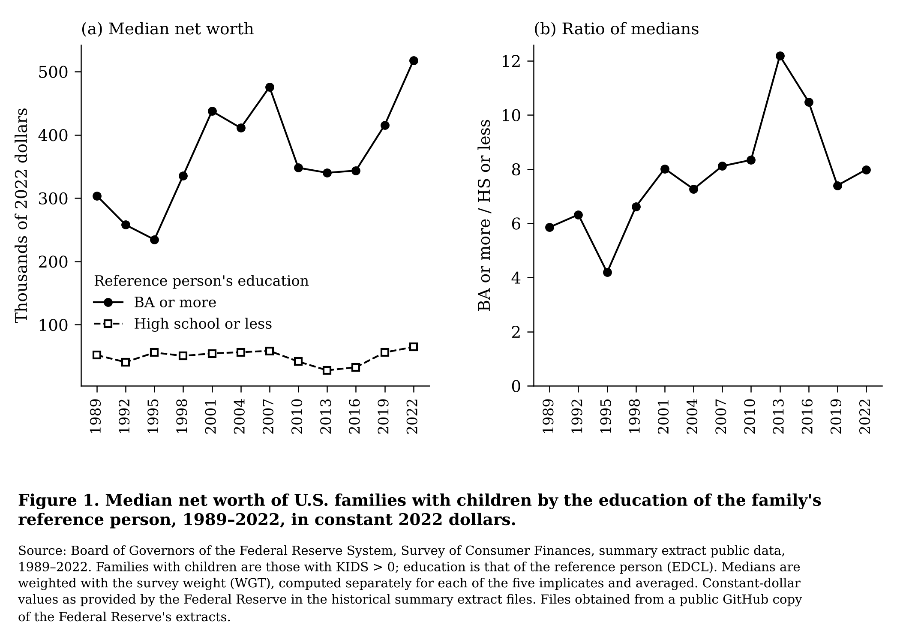

# POLISCI 158, Section 3, Option B: wealth by parents' education



**Figure 1** shows median net worth of U.S. families with children whose
reference person has a bachelor's degree or more, compared with families whose
reference person has a high-school education or less, 1989–2022. Panel (b)
shows the ratio of the two medians.

## Where the data come from

The data are the Federal Reserve Board's **Survey of Consumer Finances (SCF),
summary extract public data**: the historical extract files `rscfpYYYY.dta`,
one per survey year (every three years, 1989–2022).

**These files were not downloaded from the Fed directly.** When this was built,
`www.federalreserve.gov` was blocked from the computer running the code. The
files were instead taken from a public GitHub repository that redistributes
the Fed's extracts:
[jamesohawkins/SCF-Comparison](https://github.com/jamesohawkins/SCF-Comparison),
pinned to commit `29c4551`. The repository says the files come from the Fed's
SCF page. I could not compare them with the Fed's originals. As a check, the
2022 file reproduces the Fed's published median net worth for all families and
for families whose reference person has a college degree (see below).

Because of this, the figure ends in **2022**. The Fed released the 2025 survey
in October 2026, but the GitHub copy predates it. Running `python get_data.py`
on a computer that can reach the Fed's website downloads the Fed's files
directly, including 2025. That route has not been tested.

`data/manifest.json` records the exact source address of every file used.

## How to rerun

```
pip install pandas matplotlib requests
python get_data.py            # from the Fed's website (includes 2025)
python get_data.py --github   # or: the GitHub copy used here (ends 2022)
python plot.py                # writes figure.png and wealth_gap.csv
```

No numbers are typed in by hand. The survey years, the files and the dollar
year all come from what `get_data.py` downloads.

## Choices

- **Families with children:** families with at least one child in the
  household (`KIDS > 0`).
- **Parents' education:** the SCF summary extract records the education of
  the family's *reference person* only (`EDCL`), not both parents. "BA or
  more" is `EDCL = 4`; "high school or less" is `EDCL` = 1 (no diploma) or
  2 (diploma or GED). Families in between (some college) are left out.
- **Survey weights:** each family appears five times in the data, once per
  imputation ("implicate"). For each implicate, the median is weighted with
  the survey weight `WGT`; the figure shows the average of the five medians.
- **Constant dollars:** the Fed's historical extract files state every year
  in the dollars of the latest survey in the set, here **2022 dollars**.
  No further inflation adjustment is applied. (When the Fed's own files are
  used, `get_data.py` instead reads the dollar year from the Fed's web pages.)

## Check against the Fed's published numbers

The Fed does not publish median wealth for families *with children* by
education, so the latest point on the BA-or-more line (2022, about $518,000)
has no direct published counterpart. The closest published figure is the
2022 median for *all* families whose reference person has a college degree:
$464,600 in the Fed's "Changes in U.S. Family Finances from 2019 to 2022"
(October 2023), Table 2. The same statistic computed from the 2022 file used
here is $464,400 when all five implicates are pooled (the Fed's method) and
$465,300 with this project's average-of-implicates method, both within 0.2%.
(The published figure was read through a web search summary, because the
Fed's site could not be opened directly.)

## Files

| File | What it is |
|---|---|
| `get_data.py` | Downloads the SCF summary extracts |
| `plot.py` | Computes the weighted medians and draws the figure |
| `figure.png` | Figure 1 |
| `wealth_gap.csv` | The numbers plotted in Figure 1 |
| `data/manifest.json` | Source address and dollar year of each file |
